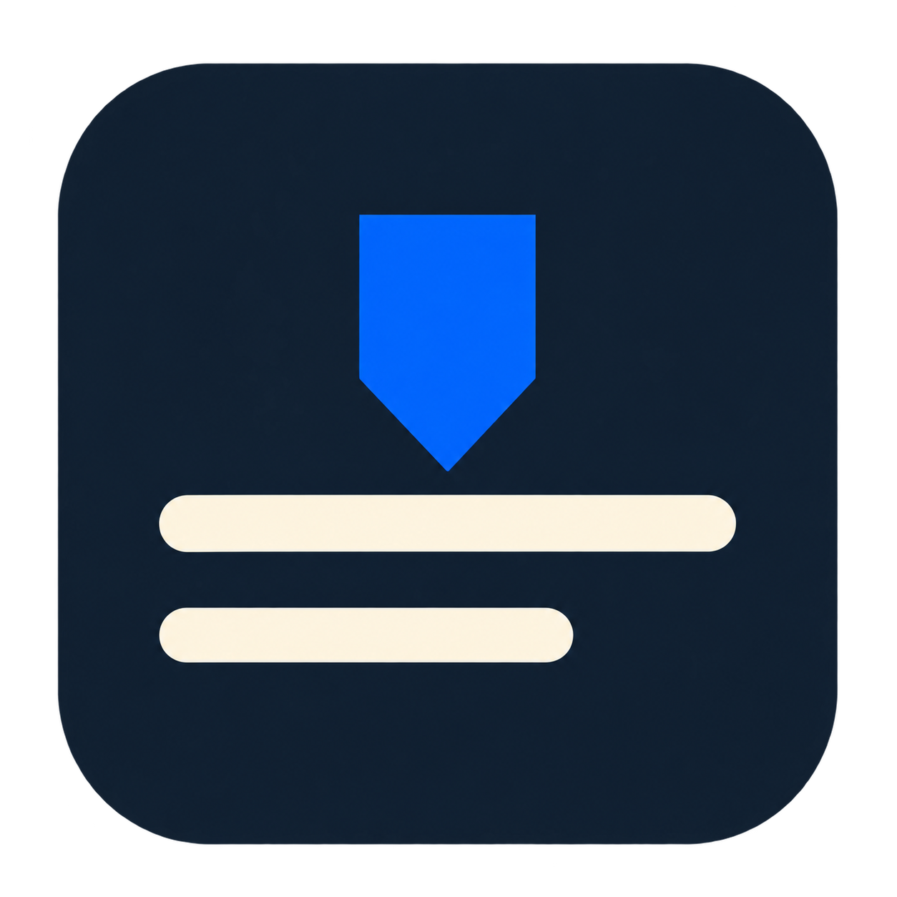

# EDLstamps



Convert DaVinci Resolve timeline marker EDL exports into YouTube chapter timestamps.

EDLstamps is a portable Windows desktop app for editors who want to turn Resolve timeline markers into YouTube chapter lines such as:

```text
0:00 Intro
0:13 Battlefield
1:44 DLSS 5
```

## Current Release

Download the Windows x64 ZIP from the [latest release](https://github.com/technicallyalex/resolve-edl-to-youtube/releases/latest). Extract it and run `EDLstamps.exe` from the extracted folder.

Use **Help > Check for Updates** to compare your installed version with the latest stable GitHub release. When a newer version is available, the app can open its release page in your browser. To update, extract the new ZIP into a fresh folder and launch its executable.

## What The App Does

- Loads DaVinci Resolve marker EDL files
- Converts timeline marker positions into YouTube timestamp format
- Uses marker names or marker comments as chapter titles
- Optionally prepends a synthetic `0:00` chapter
- Copies generated chapters to the clipboard
- Exports generated chapters to a plain text file

## Current App Behavior

- Selecting an `.edl` file automatically loads it and generates chapters
- Editing options automatically refreshes the chapter output
- The app can be launched with an EDL path argument
- The default display mode is `Light`
- A `View` menu lets you switch between `Light`, `Dark`, and `System`
- Thin scrollbars auto-hide unless content overflows
- The status area only appears when there is something to report

## Included Files

- `resolve_edl_to_youtube_gui.py`
  Python source for the GUI app
- `build_portable_exe.bat`
  Rebuild script for the portable executable
- [Logo](assets/app-logo.png) and [wordmark](assets/edlstamps-wordmark.png)

## Recommended Use

For most users:

1. Download and extract the Windows ZIP from Releases.
2. Run `EDLstamps.exe`.
3. Click `Browse` and select your Resolve marker `.edl` file.
4. The file loads and chapters generate automatically.
5. Adjust options if needed.
6. Use `Copy to Clipboard` or `Save as Text File`.

## Supported Input

The app is built for DaVinci Resolve timeline marker EDL exports, including marker lines such as:

```text
|C:ResolveColorBlue |M:Battlefield |D:1
```

It also supports older `MARKER:` style lines.

## Options

- `FPS`
  Timeline frame rate used to interpret timecode
- `Use marker comments`
  Uses the marker comment instead of the marker name
- `Dedupe consecutive lines`
  Removes repeated adjacent chapter lines
- `Prepend 0:00 chapter`
  Adds a synthetic first chapter when the first marker starts later
- `Intro` title field
  Sets the label used for the synthetic `0:00` chapter

## Display Modes

From the menu bar:

- `View > Light`
- `View > Dark`
- `View > System`

`System` follows the Windows app theme setting while the app is running.

## Launching With a File Path

The app can open an EDL directly from the command line:

```powershell
.\EDLstamps.exe "C:\path\to\Edit.edl"
```

## Running From Python

Run the source version:

```powershell
python -m pip install -r requirements.txt
python .\resolve_edl_to_youtube_gui.py
```

Or pass an EDL file path:

```powershell
python .\resolve_edl_to_youtube_gui.py "C:\path\to\Edit.edl"
```

## Building The Portable EXE

To build the Windows app with 64-bit Python:

```powershell
python -m pip install -r requirements-build.txt
.\build_portable_exe.bat
```

Run `dist\qt\EDLstamps\EDLstamps.exe` and keep the entire output folder together.

## Notes

- Built for Windows
- Designed for DaVinci Resolve timeline marker EDL exports
- Portable Windows folder using Qt Widgets through PySide6
- If Resolve changes its EDL marker export format, the parser may need updates

## Repo Purpose

This repository exists so people can:

- download a ready-to-run Windows executable
- inspect the Python source
- rebuild the executable themselves
- adapt the parser for their own Resolve workflow under the [MIT license](LICENSE)

## AI disclosure

The maintainer confirmed on 2026-10-31 that ChatGPT was used for this project. The available records do not establish the specific tasks, affected files, model versions, or proportion of AI-generated material.

OpenAI Codex was used for the 2026-10-31 repository audit and to draft these disclosure and licensing documentation changes. This describes this audit only and does not establish earlier Codex use.

OpenAI Codex was used for the Qt migration and release checker in v1.1.0. OpenAI image generation was used for the EDLstamps logo and wordmark.

## License and third-party components

The project's source and documentation are [MIT licensed](LICENSE). You may modify, fork and redistribute covered material under those terms. Keep the copyright notice, including the original repository URL, and the permission notice with copies or substantial portions.

Python, Qt, PySide6, PyInstaller and other bundled components retain their own terms. The MIT license does not relicense them or grant rights to DaVinci Resolve, YouTube, third-party trademarks, or your input media. See [dependency, attribution and build-provenance notes](docs/THIRD_PARTY_NOTICES.md).
