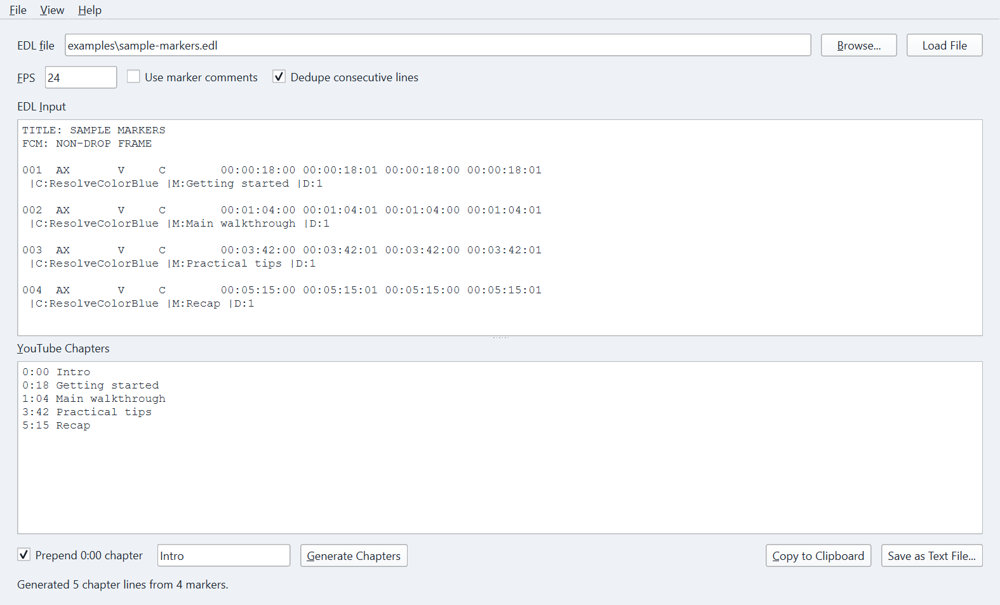
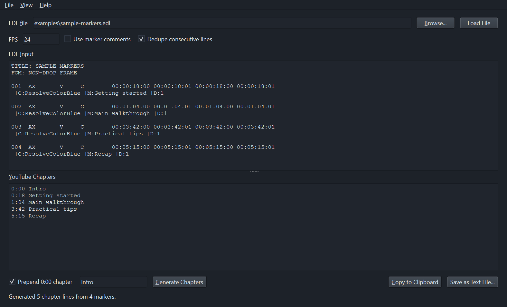

# EDLstamps


**Turn DaVinci Resolve timeline markers into YouTube chapters.** EDLstamps is a portable Windows app that reads marker EDL exports and generates timestamped chapter titles you can paste into a video description.

[Download for Windows x64](https://github.com/technicallyalex/EDLstamps/releases/latest) · [Try the sample EDL](examples/sample-markers.edl) · [View the wordmark](assets/edlstamps-wordmark.png)

## Screenshots



<details>
<summary>See Dark mode</summary>



</details>

## Quick Start

1. Download and extract the Windows x64 ZIP from [Releases](https://github.com/technicallyalex/EDLstamps/releases/latest). Run `EDLstamps.exe` from the extracted folder. No installer or Python installation is required.
2. Export your timeline markers from DaVinci Resolve as an EDL. In EDLstamps, select **Browse** to open the file, or paste its contents into **EDL Input**. You can also use the sample EDL above.
3. Set **FPS** to match the timeline. The **YouTube Chapters** pane updates as you change the input and options.
4. Select **Copy to Clipboard** to paste the chapters into a YouTube description, or **Save as Text File** to keep a `.txt` copy.

The sample produces:

```text
0:00 Intro
0:18 Getting started
1:04 Main walkthrough
3:42 Practical tips
5:15 Recap
```

## Features

| Feature | What it does |
| --- | --- |
| Live preview | Generates chapters when you load or edit an EDL or change conversion options. Supports Resolve timeline marker records and older `MARKER:` lines. |
| Chapter titles | Uses marker names by default. Select **Use marker comments** to use comments instead. |
| Opening chapter | **Prepend 0:00 chapter** adds an opening chapter when the first marker starts later. Edit its title in the adjacent field. |
| Duplicate lines | **Dedupe consecutive lines** removes identical adjacent timestamp-and-title lines. |
| Output | Copies the chapter list to the clipboard or saves it as plain text. |
| Display | **View** offers Light, Dark, and System modes. Drag the divider between the input and output panes to resize them. |
| Updates | **Help > Check for Updates** checks the latest stable GitHub release and can open its download page. Extract a newer ZIP into a fresh folder to update. |

## Command Line

To open a marker EDL directly from the extracted Windows app folder:

```powershell
.\EDLstamps.exe "C:\path\to\sample-markers.edl"
```

## Build From Source

Run the app with 64-bit Python on Windows:

```powershell
python -m pip install -r requirements.txt
python .\edlstamps.py
```

To build the portable app:

```powershell
python -m pip install -r requirements-build.txt
.\build_portable_exe.bat
```

Launch `dist\qt\EDLstamps\EDLstamps.exe`. Keep the entire output folder together, including `_internal`.

## License and Credits

Project source and documentation are [MIT licensed](LICENSE). Bundled libraries and runtime components retain their respective licenses. See [third-party notices and build provenance](docs/THIRD_PARTY_NOTICES.md).

ChatGPT assisted with the project. Codex assisted with the licensing audit, Qt migration, update checker, and repository documentation. OpenAI image generation was used for the logo and wordmark.
